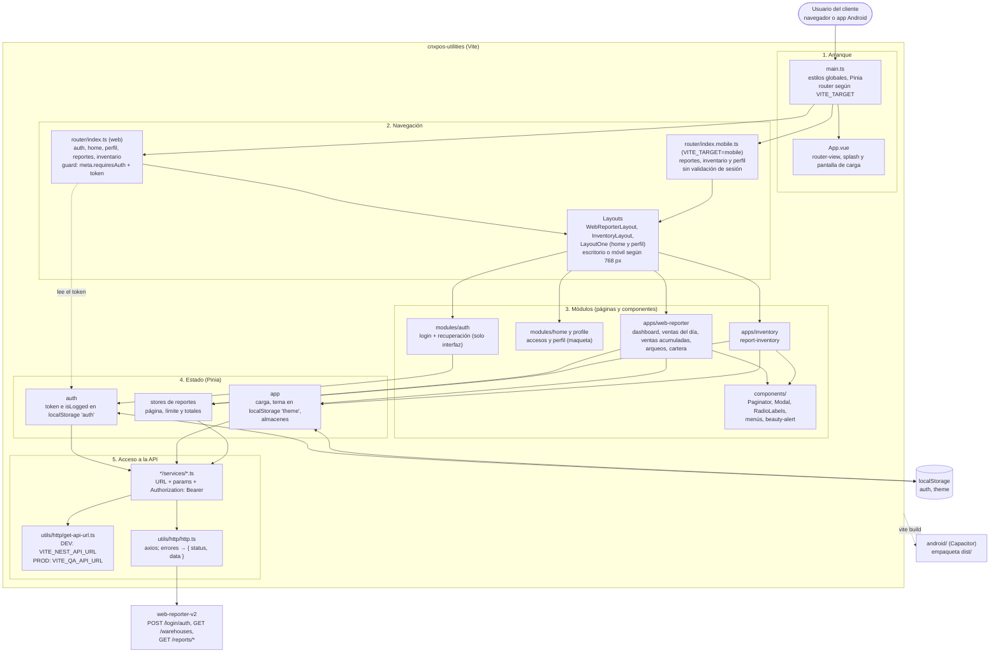
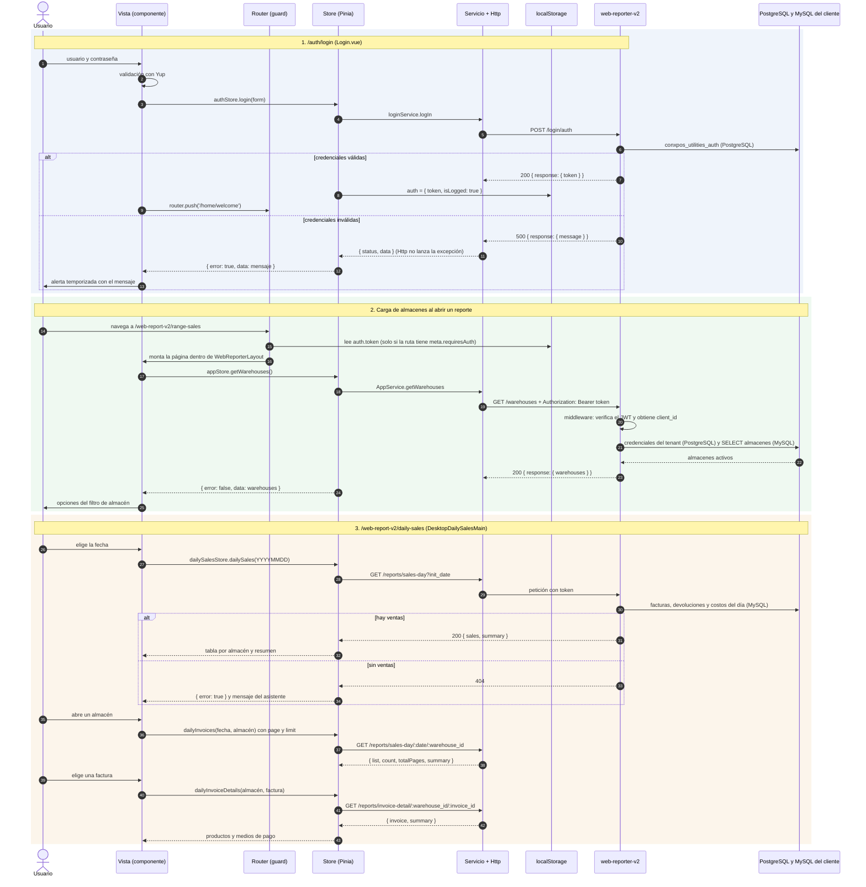
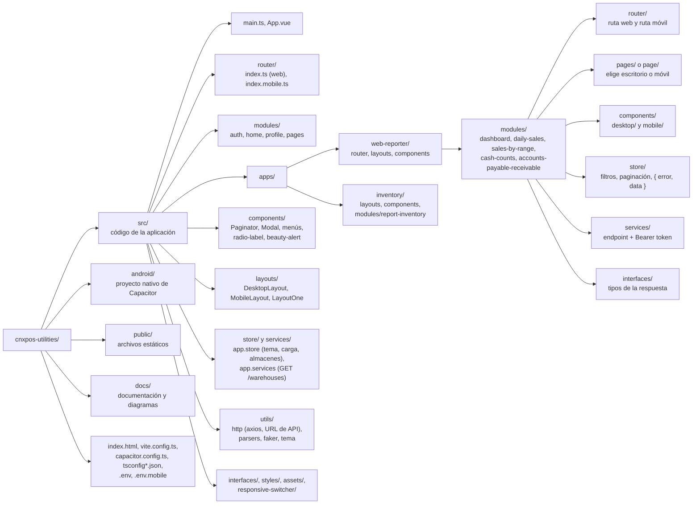

# Arquitectura: cnxpos-utilities (front del web reporter)

`cnxpos-utilities` es la aplicación con la que los clientes de Conexión POS consultan sus informes: dashboard, ventas del día, ventas acumuladas, arqueos de caja, cartera e inventario. Funciona en el navegador y como app Android (Capacitor). Todos los datos vienen de la API `web-reporter-v2`, que autentica al usuario y consulta la base MySQL de su negocio.

| Aspecto | Valor |
| --- | --- |
| Framework | Vue 3 (`<script setup>` + TypeScript) sobre Vite 7 |
| Estado | Pinia; sesión y tema persistidos con `useStorage` (`@vueuse/core`) |
| Navegación | Vue Router 4; un router web y otro móvil según `VITE_TARGET` |
| HTTP | axios envuelto en `src/utils/http/http.ts` |
| Gráficas | Chart.js (`chart.js/auto`); vue-chartjs está instalado pero no se usa |
| Validación | Yup (formulario de login) |
| Alertas | Sistema propio `components/beauty-alert` (adaptadores vanilla y Vue) |
| Móvil | Capacitor 8 (`android/`, `webDir: dist`) |
| Backend | `web-reporter-v2` (puerto 3200 por defecto) |

La guía funcional previa (arranque, rutas web y móvil, endpoints, comandos y cómo añadir un reporte) está en [FUNCIONAMIENTO.md](FUNCIONAMIENTO.md); este documento la complementa con diagramas y observaciones.

## 1. Vista general

Fuente del diagrama: [arquitectura.mmd](arquitectura.mmd).

## 2. Capas y responsabilidades

| Capa | Ubicación | Responsabilidad |
| --- | --- | --- |
| Arranque | `src/main.ts`, `src/App.vue` | Estilos globales, Pinia, elección del router por `VITE_TARGET`, splash y pantalla de carga. |
| Navegación | `src/router/`, `*/router/*.ts` | Catálogo de rutas web y móvil. El guard web exige token solo en rutas con `meta.requiresAuth`. |
| Layouts | `src/layouts/`, `apps/*/layouts/` | Marco de cada aplicación (encabezado, menú, tema, cierre de sesión). Escritorio o móvil según 768 px. |
| Páginas | `*/pages/`, `*/page/` | Eligen el componente de escritorio o móvil del módulo. |
| Componentes | `*/components/desktop`, `*/components/mobile`, `src/components/` | Filtros, tablas, tarjetas, modales y gráficas. |
| Stores | `*/store/*.ts`, `src/store/app.store.ts` | Paginación y filtros; llaman al servicio y devuelven `IStoreResponse { error, data }`. |
| Servicios | `*/services/*.ts`, `src/services/app.services.ts` | Arman la URL, los `params` y el encabezado `Authorization: Bearer`. |
| Cliente HTTP | `src/utils/http/` | axios; los errores se devuelven como `{ status, data }` en lugar de lanzarse. |

## 3. Configuración de la API y sesión

- `getApiUrl()` usa `VITE_NEST_API_URL` en desarrollo y `VITE_QA_API_URL` en un build de producción. Las variables `VITE_*` quedan dentro del bundle: no deben contener secretos.
- `VITE_TARGET=mobile` (archivo `.env.mobile`, `vite --mode mobile`) activa `router/index.mobile.ts`.
- `authStore` guarda `{ token, isLogged }` en `localStorage` bajo la clave `auth`. "Salir" solo vacía ese objeto: el token no se revoca en la API ni se revisa su vencimiento en el front.
- Los servicios de reportes leen `useAuthStore()` al importarse el archivo; `AppService.getWarehouses()` lo lee en cada llamada.

## 4. Flujo de datos

Fuente del diagrama: [flujo-datos.mmd](flujo-datos.mmd).

## 5. Estructura del proyecto

Fuente del diagrama: [estructura.mmd](estructura.mmd).

## 6. Observaciones técnicas

Problemas detectados en las pruebas funcionales del 2026-10-09 (este front + `web-reporter-v2`) y al revisar el código. No se corrigieron en esta documentación; el informe completo está en `Syscomp-docs/Documentacion markdown/Pagina web/web-reporter-status.md`.

| Tema | Detalle |
| --- | --- |
| Cifras de ventas inconsistentes | Para el mismo día y almacén, ventas por día y ventas acumuladas muestran productos y costo distintos. El origen está en las consultas de la API. |
| Utilidad | Ventas por día calcula la utilidad sobre el total con IVA; ventas acumuladas no resta las devoluciones. |
| Login | Con credenciales inválidas la API responde 500 y con mensajes distintos para usuario inexistente y contraseña incorrecta, lo que permite enumerar usuarios. El front muestra ese mensaje tal cual. |
| Sesión sin vencimiento | La API verifica el JWT con `ignoreExpiration` y el front no revisa `exp`; "Salir" solo borra el token del navegador. |
| Retenciones | La API no devuelve la retención: en el detalle de factura el total no cuadra con el pago. |
| Perfil y recuperación | "Guardar contraseña" del perfil no tiene acción y las pantallas de "olvidé mi contraseña" no llaman a ninguna API. |
| Validación de filtros | No se valida el formato de fecha ni que la fecha inicial sea menor o igual a la final, y la API no limita `limit`. En ventas acumuladas el botón Buscar se deshabilita sin explicar por qué. |
| Servicios muertos | `modules/home/services/Home.services.ts` y `modules/profile/services/Profile.services.ts` llaman a `/auth/login`, ruta inexistente en la API (la real es `/login/auth`). |
| Rutas sin protección | Solo dashboard y ventas del día declaran `meta.requiresAuth`; ventas acumuladas, arqueos, cartera, inventario y perfil se pueden abrir sin token (la API responde 401). El router móvil no valida sesión. |
| Router móvil | No registra login ni home; `registers` apunta al componente de ventas acumuladas y `range-sales` al de escritorio. |
| Estado entre vistas | Escritorio y móvil no comparten filtros ni resultados: al cambiar el ancho de la ventana se pierden. |
| Archivos con nombres parecidos | `ARQUITECTURA.md` y el antiguo `arquitectura.md` chocaban en sistemas de archivos que no distinguen mayúsculas; por eso la guía previa se movió a `FUNCIONAMIENTO.md`. |

## 7. Documentos relacionados

- [MODULOS.md](MODULOS.md): rutas, vistas, stores y endpoints de cada módulo.
- [FUNCIONAMIENTO.md](FUNCIONAMIENTO.md): guía funcional, comandos y cómo añadir un reporte.
- [README.md](README.md): índice de la carpeta y estilo de comentarios del código.
- API consumida: `web-reporter-v2/docs/`.
