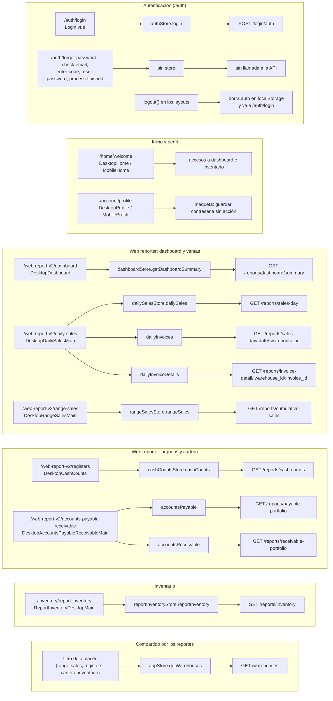

# Módulos de cnxpos-utilities

Detalle de cada módulo: rutas, vistas, store y endpoints de `web-reporter-v2` que utiliza. Los reportes tienen versión de escritorio y móvil; la página del módulo elige una u otra según el ancho de la ventana (768 px) o por CSS (`hide-on-mobile` / `hide-on-desktop`).

## Mapa de funciones

Fuente del diagrama: [funciones.mmd](funciones.mmd).

## Autenticación (`src/modules/auth`)

| Ruta | Vista | Store / acción | Endpoint |
| --- | --- | --- | --- |
| `/auth/login` | `forms/Login.vue` dentro de `AuthPage` | `authStore.login` | `POST /login/auth` |
| `/auth/forgot-password` | `forms/ForgotPasswordForm.vue` | — | Ninguno (solo interfaz) |
| `/auth/check-email`, `/auth/enter-code`, `/auth/reset-password`, `/auth/process-finished` | `forms/*.vue` | — | Ninguno (solo interfaz) |

- El login valida los campos con Yup, guarda el token en `localStorage` (`auth`) y navega a `/home/welcome`. Si la API responde con error muestra su mensaje en una alerta temporizada (`beauty-alert`, adaptador `timer`).
- Cada ruta define en `meta.headerComponent` el mensaje del asistente "Beto" (`components/beto-messages/`).
- El cierre de sesión está en los layouts (`logout()`): vacía `auth` y navega a `/auth/login`.

## Inicio y perfil (`src/modules/home`, `src/modules/profile`)

| Ruta | Vista | Comportamiento |
| --- | --- | --- |
| `/home/welcome` | `HomePage` → `DesktopHome` / `MobileHome` | Accesos al dashboard del web reporter y al inventario. |
| `/account/profile` | `ProfilePage` → `DesktopProfile` / `MobileProfile` | Maqueta: elección de avatar y cambio de contraseña sin acción. |

`Home.services.ts` y `Profile.services.ts` definen `logIn` contra `/auth/login`, ruta que no existe en la API; no se usan. Sus stores están vacíos.

## Web reporter (`src/apps/web-reporter`)

Las rutas cuelgan de `/web-report-v2` y se muestran dentro de `WebReporterLayout` (menú con `MenuOptions`: ventas acumuladas, ventas del día, dashboard, arqueos y cartera).

| Módulo | Ruta | Componente principal | Store / acción | Endpoint |
| --- | --- | --- | --- | --- |
| dashboard | `/web-report-v2/dashboard` | `DesktopDashboard` / `MobileDashboard` | `dashboardStore.getDashboardSummary` | `GET /reports/dashboard/summary` |
| daily-sales | `/web-report-v2/daily-sales` | `DesktopDailySalesMain` / `MobileDailySalesMain` | `dailySalesStore.dailySales` | `GET /reports/sales-day?init_date` |
| daily-sales | modal de facturas o `/web-report-v2/invoices/:date/:warehouse_id` | `DesktopDailySalesMain` / `InvoicesMain` | `dailySalesStore.dailyInvoices` | `GET /reports/sales-day/:date/:warehouse_id` |
| daily-sales | detalle o `/web-report-v2/invoice-details/:warehouse_id/:invoice_id` | `DesktopDailySalesMain` / `InvoicesDetails` | `dailySalesStore.dailyInvoiceDetails` | `GET /reports/invoice-detail/:warehouse_id/:invoice_id` |
| sales-by-range | `/web-report-v2/range-sales` | `DesktopRangeSalesMain` / `MobileRangeSalesMain` | `rangeSalesStore.rangeSales` | `GET /reports/cumulative-sales` |
| cash-counts | `/web-report-v2/registers` | `DesktopCashCounts` / `MobileCashCounts` | `cashCountsStore.cashCounts` | `GET /reports/cash-counts` |
| accounts-payable-receivable | `/web-report-v2/accounts-payable-receivable` | `DesktopAccountsPayableReceivableMain` / `MobileAccountsPayableReceivable` | `accountsPayable` / `accountsReceivable` | `GET /reports/payable-portfolio` / `GET /reports/receivable-portfolio` |

Detalles por módulo:

- **dashboard**: envía la fecha de hoy como `init_date`/`end_date`, pero la API calcula sus propios rangos (hoy y últimos 7 días). La gráfica usa `BarChart` (escritorio) o `BarChart2` (móvil) sobre Chart.js y el tema se aplica con `useChartTheme`.
- **daily-sales**: la fecha se envía como `YYYYMMDD`. Las facturas se paginan con `page` y `limit` del store (5 por página).
- **sales-by-range**: exige rango de fechas y almacén o "todos" (`warehouse_id = 0`); 6 filas por página.
- **cash-counts**: consulta por fecha y almacén; muestra apertura, cierre, ventas, salidas y pagos.
- **accounts-payable-receivable**: alterna entre cuentas por pagar y por cobrar; 5 filas por página.

## Inventario (`src/apps/inventory`)

| Ruta | Componente principal | Store / acción | Endpoint |
| --- | --- | --- | --- |
| `/inventory/report-inventory` | `ReportInventoryDesktopMain` / `ReportInventoryMobileMain` | `reportInventoryStore.reportInventory` | `GET /reports/inventory` (`warehouse_id`, `page`, `limit`, `search`) |

Se muestra dentro de `InventoryLayout`. Su `MenuOptions` es una copia del del web reporter y navega a las rutas `/web-report-v2/*`.

## Compartido

| Pieza | Ubicación | Uso |
| --- | --- | --- |
| Almacenes | `appStore.getWarehouses` → `AppService.getWarehouses` | `GET /warehouses` para los filtros de ventas acumuladas, arqueos, cartera e inventario. |
| Pantalla de carga | `appStore.afterLoading(fn)` | Muestra `LoadingScreen` mientras se ejecuta una carga. |
| Tema | `utils/theme-transitions.ts`, `appStore.theme` | Claro u oscuro, persistido en `localStorage` (`theme`). |
| Paginación | `components/Paginator.vue` | Emite la página elegida; el componente actualiza `store.page` y vuelve a consultar. |
| Alertas | `components/beauty-alert/` | `createAlertCore(vueAdapters)` con tipos `confirm` y `timer`. |
| Formatos | `utils/parsers/` | Moneda COP y fechas. |
| Datos de prueba | `utils/faker/` | Generador de datos falsos usado por servicios comentados. |

## Router móvil (`VITE_TARGET=mobile`)

`src/router/index.mobile.ts` registra ventas acumuladas, perfil, inventario, arqueos, cartera, ventas del día (`/daily-sales/daily-sales`) y dashboard. No registra login ni home, redirige `/` a `/home/welcome` y no valida la sesión. Algunas rutas reutilizan componentes de otros módulos (por ejemplo, `registers` muestra `MobileRangeSalesMain`). Ver [ARQUITECTURA.md](ARQUITECTURA.md), sección "Observaciones técnicas".
